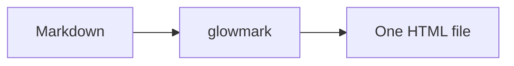

# One file in. One beautiful page out.

This page was generated by the **actual Python engine** at build time — the same
code path as `glowmark doc.md`. There is no JavaScript imitation here.

## Everything you need

1. Point glowmark at a file.

   ```bash
   glowmark notes.md --out notes.html
   ```

2. Or keep a live preview open while you write.

   ```bash
   glowmark --serve notes.md
   ```

## GFM that behaves like GitHub

| Feature | Supported | Notes |
| --- | --- | --- |
| Tables | ✅ | GFM pipe tables |
| Task lists | ✅ | Real checkboxes |
| Footnotes | ✅ | With backlinks |
| Nested code | ✅ | Fences inside list items |

- [x] CommonMark parsing
- [x] GitHub-style alerts
- [ ] Take over the world

> [!TIP]
> Edit the source file and run `glowmark --serve` — the browser refreshes
> itself. No build step, no account, no network for the core page.

## Unicode is safe

Em dash —, arrow →, μ-law, café, naïve, 東京, ✨. Bytes are decoded as UTF-8,
with BOMs and CRLF handled before the renderer sees them.

## Math and diagrams

Inline math $e^{i\pi} + 1 = 0$ and a small diagram:



A footnote for the curious.[^1]

[^1]: The standalone page inlines its CSS, JavaScript and syntax-highlighting
    theme. Math (KaTeX) and mermaid load from a CDN only when detected.
