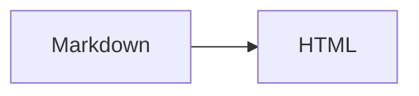

# Kitchen Sink

Intro with non-ASCII: em dash —, arrow →, micro μ-law, café, naïve, 東京, ✨.

## Nested lists and code

1. Connect the service.

   ```bash
   echo "straight quotes stay straight"
   ```

2. Add a webhook.

   - Nested bullet

     ```javascript
     const ok = true; // nested fence
     ```

3. Done.

## Tables

| Feature | Command | Works |
| --- | --- | --- |
| Preview | `glowmark doc.md` | yes |
| Export | `glowmark doc.md -o page.html` | yes |

## Tasks

- [x] Parse markdown
- [ ] Take over the world

## Alerts

> [!NOTE]
> Useful information.

> [!TIP]
> Helpful advice.

> [!WARNING]
> Be careful.

> [!IMPORTANT]
> Important.

> [!CAUTION]
> Caution.

## Quotes and escapes

> A plain blockquote.

Escaped: \*not emphasis\*, \_not emphasis\_, \& ampersand.

## Footnotes

A footnote reference.[^1]

[^1]: The footnote body with **markdown**.

## Math and diagrams

Inline math $e^{i\pi} + 1 = 0$.

$$
\int_{-\infty}^{\infty} e^{-x^2} dx = \sqrt{\pi}
$$



## Duplicate headings

### Repeated

### Repeated

## Last section

Strikethrough ~~gone~~ and a [link](https://example.com).
